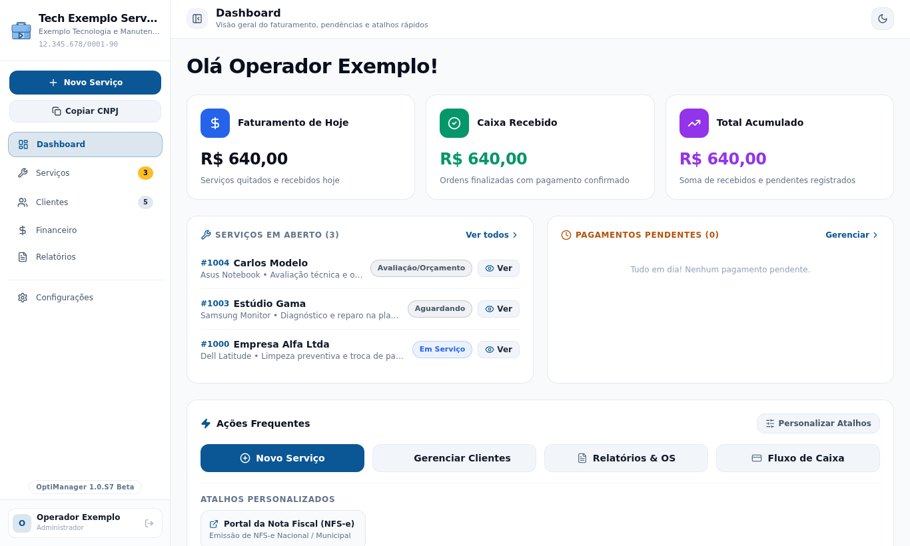

<div align="center">

# OptiManager

**Sistema web auto-hospedado para gestão de ordens de serviço e pequenos negócios**

[](docs/arch.md)
[](docs/build.md)
[](LICENSE)

*Aplicação web leve, rápida e auto-hospedada em container Docker (Go + Vue 3 + SQLite), projetada para micro e pequenos empreendedores, assistências técnicas e prestadores de serviço gerenciarem ordens de serviço, clientes, relatórios e faturamento localmente.*

</div>

---

## Capturas de tela

| Dashboard | Gerador de documentos (A4 monocromático) |
| :---: | :---: |
|  |  |

---

## Principais recursos

| Módulo | Descrição | Documentação |
| :--- | :--- | :--- |
| **Autenticação e usuários** | Assistente inicial de 6 passos, login HMAC-SHA256 e controle RBAC | [autenticacao-e-usuarios.md](docs/modules/autenticacao-e-usuarios.md) |
| **Dashboard e atalhos** | Métricas resumidas, recomendações, ações frequentes e atalhos rápidos | [dashboard-e-atalhos.md](docs/modules/dashboard-e-atalhos.md) |
| **Ordens de serviço** | Criação, edição, conclusão, ações em lote e baixa de pagamento | [ordens-de-servico.md](docs/modules/ordens-de-servico.md) |
| **Clientes** | Cadastro com busca, autocompletar em OS e contato via WhatsApp | [clientes.md](docs/modules/clientes.md) |
| **Financeiro** | Fluxo de recebimentos, indicadores e exportação CSV | [financeiro.md](docs/modules/financeiro.md) |
| **Relatórios e PDF** | Gerador A4 monocromático na UI e PDF nativo via Maroto v2 | [relatorios-e-pdf.md](docs/modules/relatorios-e-pdf.md) |
| **Configurações** | Logo, accent colors, presets de OS/serviços e auto-logout | [configuracoes.md](docs/modules/configuracoes.md) |
| **Backup e restauração** | Snapshots atômicos `VACUUM INTO`, `.zip`, agendador e retenção | [backup-e-restauracao.md](docs/modules/backup-e-restauracao.md) |
| **Auditoria e privacidade** | Tabela `audit_log`, redação LGPD em logs/erros e `TRUST_PROXY` | [auditoria-e-privacidade.md](docs/modules/auditoria-e-privacidade.md) |
| **Migração legada DBF** | Subcomando CLI `profile-dbf` para inspeção de bases DBF | [migracao-legada-dbf.md](docs/modules/migracao-legada-dbf.md) |
| **Saúde e monitoramento** | Endpoint `GET /api/health` e healthcheck Docker | [saude-e-monitoramento.md](docs/modules/saude-e-monitoramento.md) |

---

## Requisitos

- **Via Docker (recomendado):** Docker e Docker Compose.
- **Para compilar do código-fonte:** Go `1.26+` e Node.js `22+` (`npm`).

---

## Instalação e primeiros passos (Docker Compose)

```bash
git clone https://github.com/jvfigueiro/optimanager.git
cd optimanager
./scripts/init-env.sh
docker compose up -d
```

Acesse `http://localhost:8585` e siga o **assistente de boas-vindas** (6 passos) para configurar o administrador e os dados da empresa.

---

## Visão geral da arquitetura modular

O OptiManager é um **monólito modular em binário único**: o frontend SPA é embutido no executável Go via `//go:embed all:dist` e os módulos verticais combinam modelos (`internal/models`), repositórios SQLite WAL (`internal/database`), serviços (`internal/services`), handlers HTTP (`internal/handlers`) e stores/views Vue (`ui/src`).

Detalhes completos e diagramas Mermaid em [docs/arch.md](docs/arch.md).

---

## Tecnologias utilizadas

- **Backend:** Go `1.26.1`, `chi/v5`, `modernc.org/sqlite` (WAL), `maroto/v2` (PDF), `golang.org/x/crypto` (`bcrypt`), `golang.org/x/text`
- **Frontend:** Vue `3.5`, TypeScript `5.7`, Pinia `2.3`, Tailwind CSS `3.4`, Vite `6.1`, `lucide-vue-next`, PWA
- **Infraestrutura:** Docker multi-stage (`alpine:3.21`), Docker Compose, `Makefile`

---

## Estrutura do projeto

```text
optimanager/
├── cmd/server/          # Ponto de entrada HTTP e CLI `profile-dbf`
├── internal/            # Núcleo Go (database, handlers, models, money, redact, services, legacy/dbf)
├── ui/                  # SPA Vue 3 + TypeScript + embedding `//go:embed all:dist`
├── scripts/             # Scripts de build, ambiente, demo e utilitários
└── docs/                # Documentação técnica, módulos e guias
```

---

## Como contribuir e criar módulos

Consulte o guia prático baseado no código real em [docs/create-module.md](docs/create-module.md) e as instruções de compilação em [docs/build.md](docs/build.md).

---

## Aviso de responsabilidade

O OptiManager armazena dados operacionais localmente no banco SQLite e permite restaurar backups que substituem a base ativa. Mantenha cópias de backup externas periódicas em local seguro.

---

## Documentação completa

- [Mapa de arquitetura (`docs/_analysis/00-map.md`)](docs/_analysis/00-map.md)
- [Visão geral e diagramas (`docs/arch.md`)](docs/arch.md)
- [Índice de módulos (`docs/modules/README.md`)](docs/modules/README.md)
- [Como criar um novo módulo (`docs/create-module.md`)](docs/create-module.md)
- [Compilação e empacotamento (`docs/build.md`)](docs/build.md)
- [Configurações, logs e auditoria (`docs/logs-and-settings.md`)](docs/logs-and-settings.md)
- [FAQ e solução de problemas (`docs/faq-and-troubleshooting.md`)](docs/faq-and-troubleshooting.md)
- [Dados, LGPD e backups (`docs/DADOS-E-BACKUPS.md`)](docs/DADOS-E-BACKUPS.md)

---

## Licença

Distribuído sob a licença **GNU General Public License v3.0 (GPLv3)**. Consulte o arquivo [LICENSE](LICENSE).
