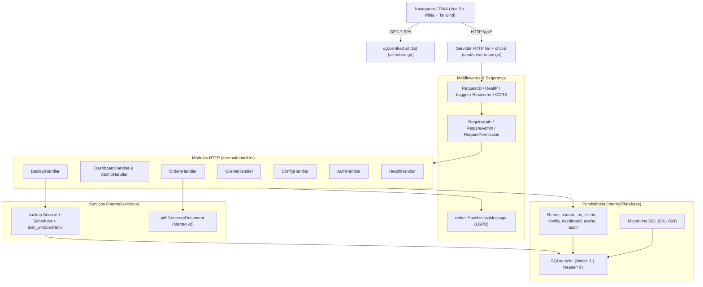
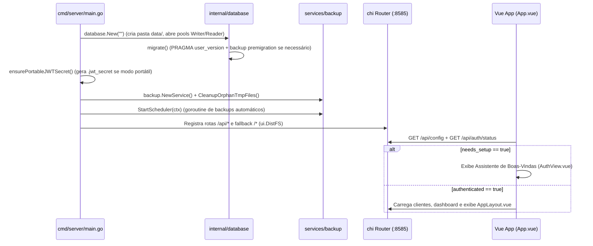

# Arquitetura do OptiManager

O **OptiManager** (`1.0.S7 Beta`) é uma aplicação web auto-hospedada construída como um **monólito modular em binário único**: o backend em Go (`cmd/server`) compila e embute o frontend SPA Vue 3 (`ui/dist` via `//go:embed all:dist`) e utiliza SQLite embarcado em modo WAL.

## Visão Geral das Camadas

1. **Camada de Apresentação (`ui/src/`):** SPA em Vue 3 + TypeScript + Tailwind CSS + Pinia. A navegação entre telas ocorre reativamente via store `navigation.ts` e hash da URL (`#dashboard`, `#orders`, `#clients`, `#finance`, `#reports`, `#settings`), sem `vue-router`.
2. **Camada de Transporte HTTP (`internal/handlers/`):** Roteador `chi/v5` expondo a API REST sob `/api/*`, com middlewares de `RequestID`, `RealIP`, `Logger`, `Recoverer`, `Timeout(120s)`, CORS e autenticação JWT/Cookie HMAC-SHA256 (`RequireAuth`, `RequireAdmin`, `RequirePermission`).
3. **Camada de Serviços (`internal/services/`):** Lógica de domínio especializada e processos em segundo plano — motor de backup (`backup`) com agendador e geração de PDF (`pdf` via Maroto v2).
4. **Camada de Persistência (`internal/database/`):** Repositórios SQLite usando dois pools separados (`Writer`: 1 conexão; `Reader`: 8 conexões), migrações SQL sequenciais controladas por `PRAGMA user_version` e concorrência otimista (`versao`).
5. **Utilitários Transversais (`internal/models/`, `internal/money/`, `internal/redact/`, `internal/legacy/dbf/`):** Entidades e permissões RBAC, aritmética em centavos, redação LGPD em erros/logs e profiler CLI de arquivos DBF.

## Diagrama da Arquitetura Modular

## Fluxo de Inicialização e Carregamento

