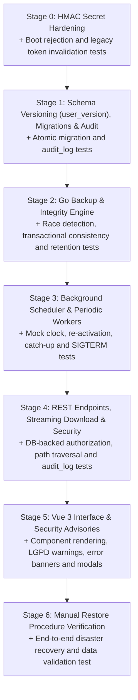

# Implementation Plan: OptiManager Backup System (Revision 5)

## Revision 5 Changelog
- **Item 1 (.env.example without pre-generated key and init-env.sh script)**: Configured `.env.example` with an obvious placeholder rejected at boot (`JWT_SECRET=CONFIGURE_UMA_CHAVE_COM_PELO_MENOS_32_CHARS_AQUI`). Created `scripts/init-env.sh` to generate a cryptographic `JWT_SECRET` via `openssl rand -hex 32` without overwriting existing `.env` files.
- **Item 2 (Restore audit log terminology)**: Removed the term "immutable" when referring to `restore_audit.log`, documenting it as an append-only file by standard convention (`os.O_APPEND`).
- **Item 3 (`premigration` origin and abort on pre-migration backup failure)**: Added the `premigration` origin to naming conventions, regular expressions (`manual|auto|prerestore|premigration`), and retention policies (`backup_retencao_premigration`, minimum 3). If pre-migration snapshot fails, database migrations are skipped and application boot aborts immediately.
- **Item 4 (Atomicity of migrations and user_version)**: Explicitly specified that each DDL/DML migration script and the `PRAGMA user_version = N` statement execute within the **same database transaction**.
- **Item 5 (Trusted proxy validation for client IP tracking)**: Client IP extraction via `X-Forwarded-For` / `X-Real-IP` (`chi/middleware.RealIP`) is enabled **only when `TRUST_PROXY=true`**; otherwise, `r.RemoteAddr` is strictly used to prevent spoofing in untrusted networks.
- **Item 6 (Strict shutdown sequence)**: Defined strict order of server shutdown: (1) stop accepting incoming HTTP requests (`server.Shutdown`); (2) wait for active in-flight backup jobs to complete (up to 30s); (3) only then close SQLite database connection pools (`db.Close()`).
- **Item 7 (Unique naming and lifecycle for `.perm_check`)**: Periodic external write checks use unique filenames (`.perm_check_<timestamp>_<rand>`) with deterministic cleanup via `defer os.Remove`, explicitly ignored by backup listing and orphan cleanup workers.
- **Item 8 (Control case for transactional consistency tests)**: Concurrency tests include a control case running against a naive file copy (without `VACUUM INTO`), proving that naive copies fail by catching inconsistent states or split rows under concurrent writes.

---

## 1. Storage Topology & Architectural Overview

OptiManager operates on **SQLite in WAL mode** stored on persistent volume storage (`/data/optimanager.db`). All application data is unified within this database:
- Institutional company profile, base64 logo, styling variables, warranty clauses, and presets (`config`)
- Users, salted bcrypt password hashes, and authorization roles (`usuarios`)
- Client registry, documents, and contacts (`clientes`)
- Work orders, technical notes, completion deadlines, and payment statuses (`ordens_servico`)
- Shortcuts and utilities (`atalhos`)
- Persistent audit trail for sensitive administrative operations (`audit_log`)

### 1.1. SQLite WAL Behavior
Backup execution leverages native SQLite atomic snapshotting:
```sql
VACUUM INTO '/data/backups/optimanager_backup_YYYY-MM-DD_HH-mm-ss_[manual|auto|prerestore|premigration].db.tmp';
```

> [!NOTE]
> **WAL Lock Characteristics:**
> `VACUUM INTO` produces a transactionally consistent snapshot without blocking concurrent active readers or inserts on the production database. However, **during its execution, WAL checkpoints do not advance**. Consequently, backup execution must remain serialized, lean, and bounded by timeouts. The resulting file is an uncorrupted `.db` file.

### 1.2. Storage Topology & Disk Failure Protection
Backups stored solely within the local application disk (`/data/backups`) do not protect against host disk crashes or volume deletion.
- **Primary Destination (Local):** `/data/backups` (or `./data/backups` during local development).
- **Secondary Destination (External, Optional):** Directory configured via environment variable `BACKUP_EXTERNAL_DIR` (e.g. `/backups-externo`, mounted via secondary Docker volume or NFS).
- **Differential Error Handling for Storage Capacity:**
  - **Insufficient space on LOCAL destination:** Aborts execution immediately with a clear error, preventing partial snapshot generation.
  - **Insufficient space or write failure on EXTERNAL destination:** The local backup succeeds and remains preserved; external synchronization failure is logged in the persistent column `backup_ultimo_aviso_externo` and prominently displayed in the UI.
- **Periodic External Storage Check (`.perm_check`):**
  - An hourly worker verifies external write permissions by creating and removing a uniquely named file (`.perm_check_<timestamp>_<rand>`) using `defer os.Remove(...)`.
  - These temporary probe files are ignored by backup inventory regexes and orphan cleanup sweeps.
- **Persistent Interface Notice:** A permanent advisory banner informs administrators that backups stored on the same server volume do not substitute off-site or external archival.

### 1.3. HMAC Session Secret & Boot Security Policy
- The secret is loaded from `JWT_SECRET`. Hardcoded static defaults are completely removed.
- **Boot Validation (Stage 0):**
  - Application boot validates `JWT_SECRET`:
    - If empty (and not in `APP_ENV=dev`): aborts immediately with `log.Fatalf`.
    - If shorter than **32 characters (256 bits)**: aborts immediately with an explanatory error.
    - If identical to deprecated fallback values: rejects boot due to compromised key material.
    - If identical to documentation placeholders: rejects boot.
  - **Development Mode (`APP_ENV=dev`):** If `JWT_SECRET` is unset, an ephemeral 32-byte cryptographic secret is generated at boot via `crypto/rand` with an explicit log warning.
- **Provisioning Scripts:**
  - `.env.example`: contains an invalid placeholder rejected at boot.
  - `scripts/init-env.sh`: provisions `.env` with a secure high-entropy key (`openssl rand -hex 32`) if `.env` does not already exist.

---

## 2. Data Model, Configuration & Audit Logging

### 2.1. Sequential Schema Versioning (`PRAGMA user_version`)
- OptiManager implements strict sequential versioning managed by numbered migration files in `internal/database/migrations/` (e.g., `001`, `002`).
- **Atomic Migrations:** Each migration script and its corresponding `PRAGMA user_version = N` update execute within the **same SQL transaction**. If any DDL/DML statement fails, the transaction rolls back completely and `user_version` remains unchanged.
- **Pre-Migration Safeguard Backup (`premigration`):** Before applying pending migrations to an existing database, the engine runs `CreateBackup("premigration")`. **If this safeguard backup fails (e.g., due to insufficient disk space), migrations are NOT executed and application boot aborts immediately.**

### 2.2. Backup Configuration Columns in `config` Table

| Column | Type | Default | Description |
|---|---|---|---|
| `backup_auto_enabled` | INTEGER | `0` | `0` = disabled, `1` = active |
| `backup_frequencia` | TEXT | `'diario'` | Restricted enum: `'diario'` or `'semanal'` |
| `backup_dia_semana` | INTEGER | `0` | `0` (Sunday) through `6` (Saturday) for weekly frequency |
| `backup_horario` | TEXT | `'02:00'` | Execution time in `HH:MM` format (America/Sao_Paulo timezone) |
| `backup_retencao_auto` | INTEGER | `7` | Number of automated backups retained (1 to 60) |
| `backup_retencao_manual` | INTEGER | `5` | Number of manual backups retained (1 to 60) |
| `backup_retencao_prerestore` | INTEGER | `3` | Number of pre-restore backups retained (3 to 60) |
| `backup_retencao_premigration` | INTEGER | `3` | Number of pre-migration backups retained (3 to 60) |
| `backup_ultimo_sucesso` | TEXT | `''` | ISO 8601 timestamp of last successful backup (empty = never) |
| `backup_ultimo_erro` | TEXT | `''` | Error message from the most recent local failure |
| `backup_ultimo_erro_em` | TEXT | `''` | ISO 8601 timestamp of the most recent local failure |
| `backup_ultimo_aviso_externo` | TEXT | `''` | Warning or error message from external copy destination |
| `backup_ultimo_aviso_externo_em` | TEXT | `''` | ISO 8601 timestamp of external sync failure |

### 2.3. Audit Log Table (`audit_log`) & Secure IP Resolution
```sql
CREATE TABLE IF NOT EXISTS audit_log (
    id INTEGER PRIMARY KEY AUTOINCREMENT,
    usuario_id INTEGER NOT NULL,
    usuario_nome TEXT NOT NULL,
    ip TEXT NOT NULL,
    acao TEXT NOT NULL,
    detalhe TEXT NOT NULL,
    created_at DATETIME NOT NULL DEFAULT CURRENT_TIMESTAMP
);
CREATE INDEX IF NOT EXISTS idx_audit_log_created_at_id ON audit_log (created_at DESC, id DESC);
```
- **IP Resolution via Proxy Validation:**
  - If `TRUST_PROXY=true`: resolves client IP via `chi/middleware.RealIP` (evaluating `X-Forwarded-For` and `X-Real-IP`).
  - If `TRUST_PROXY` is false or unset: strictly resolves IP from `r.RemoteAddr`, preventing header forgery in direct access topologies.
- **Retention Policy:** Default policy retains records for 365 days (`audit_retencao_dias INTEGER DEFAULT 365`).

---

## 3. Backend (Go): Backup Service & Integrity

The backup subsystem resides in `internal/services/backup/service.go`.

### 3.1. Startup & Orphan Cleanup
At application startup:
1. Verifies and creates `/data/backups` and the external directory (if configured).
2. Cleans up orphan `*.db.tmp` and `.perm_check*` files left by abrupt process terminations.
3. Performs initial write verification using `.perm_check_<timestamp>_<rand>`.

### 3.2. Concurrency & Safe Creation (`CreateBackup`)
1. **Strict Serialization:** Guaranteed through `sync.Mutex`. Manual, automated, pre-restore, and pre-migration backups never execute concurrently.
2. **Storage Capacity Checks:**
   - Local destination: Requires free space >= 2x active database file size. Aborts if space is insufficient.
   - External destination: Requires free space >= 2x active database file size. Logs warning if space is insufficient while allowing local backup to proceed.
3. **Collision Avoidance with Context Cancellation:**
   - Filename follows format: `optimanager_backup_YYYY-MM-DD_HH-mm-ss_[manual|auto|prerestore|premigration].db`.
   - On collision within the same second:
     ```go
     select {
     case <-ctx.Done():
         return nil, ctx.Err()
     case <-time.After(1 * time.Second):
     }
     ```
     Retries up to 3 times before returning an error.
4. **Temporary File:** Initial snapshot is written to `...db.tmp`.
5. **Post-Creation Integrity Check:**
   - Opens `.db.tmp` via a separate read-only SQLite connection.
   - Executes `PRAGMA integrity_check;`. If output is anything other than `"ok"`, removes `.tmp` and returns an error.
6. **Atomic Rename:** Renames `os.Rename(tmpFile, finalFile)`. A deferred recovery handler ensures `.db.tmp` is deleted on any failure.
7. **External Copy (if configured):** Copies verified backup file to external directory. On failure, updates `backup_ultimo_aviso_externo` without invalidating the local backup.
8. **State Update:** Updates `backup_ultimo_sucesso = now` and clears `backup_ultimo_erro`.
9. **Retention Pruning:** Invokes `ApplyRetention(origin)`.

### 3.3. Isolated Retention Rules (`ApplyRetention`)
Pruning operates in strict isolation per origin:
- `manual`: retains newest `backup_retencao_manual` copies (default 5, range 1-60).
- `auto`: retains newest `backup_retencao_auto` copies (default 7, range 1-60).
- `prerestore`: retains newest `backup_retencao_prerestore` copies (default 3, range 3-60).
- `premigration`: retains newest `backup_retencao_premigration` copies (default 3, range 3-60).

**Safeguards:**
- Pruning runs **strictly after** the new file is verified and moved into place.
- **Minimum Threshold:** Never deletes files if the remaining count for that origin would drop below 1.
- Matching external copies are removed synchronously with local pruning.

---

## 4. Background Scheduler

The scheduler logic resides in `internal/services/backup/scheduler.go`.

### 4.1. Timezone & Embedded Zoneinfo
- Includes blank import `import _ "time/tzdata"`.
- Uses `time.LoadLocation("America/Sao_Paulo")`.
- `Dockerfile` and `docker-compose.yml` set `TZ=America/Sao_Paulo`.

### 4.2. Overdue Logic, Initial Activation & Catch-Up
1. **When `backup_auto_enabled == 0`**: Scheduler remains idle.
2. **First Activation (`backup_ultimo_sucesso == ""`):**
   - Does not run immediately at activation. Schedules execution for the next upcoming configured window.
3. **Re-activation with Outdated Last Success:**
   - If a routine was disabled and later re-enabled (`backup_auto_enabled = 1`) with `backup_ultimo_sucesso` older than the last expected execution window, the scheduler detects overdue status and runs an immediate **catch-up** backup.
4. **Ongoing Periodic Runs:**
   - If `now >= expected_window` and `backup_ultimo_sucesso < expected_window`, runs immediately (handling post-downtime recovery).

### 4.3. Strict Shutdown Order & Docker Grace Period
- In `docker-compose.yml`:
  ```yaml
  stop_grace_period: 40s
  ```
- **Server Shutdown Sequence:**
  1. Server stops accepting incoming HTTP requests (`server.Shutdown(ctx)`).
  2. Waits up to **30 seconds** for any active `CreateBackup` operation to conclude.
  3. Closes database connection pools (`db.Close()`).
  4. Docker daemon provides 40s stop grace period, giving a 10s buffer before issuing `SIGKILL`.

---

## 5. Security, Audit & API Endpoints

Endpoints located under `/api/backups` enforce admin role verification directly against SQLite:

| Method | Endpoint | Validation & Security Rules |
|---|---|---|
| `GET` | `/api/backups` | Lists existing backup snapshots. Filters out files not matching regex. Returns metadata, routine status, and external warnings. |
| `POST` | `/api/backups` | Triggers immediate creation of `manual` backup. Serialized via Mutex. Recorded in `audit_log`. |
| `GET` | `/api/backups/config` | Retrieves routine schedule, retention thresholds, last status, and errors. |
| `PUT` | `/api/backups/config` | Validates payload: frequency enum, weekday, time `HH:MM`, and retention bounds. Recorded in `audit_log`. |
| `GET` | `/api/backups/{filename}/download` | Strict regex validation + `filepath.Rel`. Streamed via `http.ServeContent` with `Content-Disposition: attachment; filename="..."` and `Cache-Control: no-store`. Recorded in `audit_log`. |
| `DELETE` | `/api/backups/{filename}` | Strict regex validation + `filepath.Rel`. Deletes local and external copies. Recorded in `audit_log`. |

### 5.1. Strict Filename Validation
Regular expression applied to `{filename}` path parameters:
```regex
^optimanager_backup_\d{4}-\d{2}-\d{2}_\d{2}-\d{2}-\d{2}_(manual|auto|prerestore|premigration)\.db$
```
Cross-checked with `filepath.Rel` to ensure no path traversal escapes the storage directory.

---

## 6. User Interface (Vue 3 / Tailwind CSS)

Dedicated Backup & Security panel in `ConfiguracoesView.vue`:
1. **Permanent Advisories:**
   - **Local Disk Failure:** Explains why local backups alone do not protect against hardware drive failure.
   - **Data Privacy & LGPD:** Notes regarding sensitive client records and credential hashes contained in snapshots.
2. **Real-Time Operational Monitoring:**
   - **Overdue Alert (> 2x schedule interval):** Highlights routines that have missed scheduled runs.
   - **Local Error Banner:** Prominently displays `backup_ultimo_erro` with failure timestamp.
   - **External Storage Warning:** Displays `backup_ultimo_aviso_externo` with warning timestamp.
   - **External Storage Health:** Visual indicator showing availability of external directory.
3. **Actions:**
   - "Create Backup Now" action button with reactive loading state.
   - Schedule configuration form (daily/weekly, day of week, execution time, and segregated retention limits).
   - Snapshot table with direct streaming download and deletion confirmation modal.

---

## 7. Database Restore Strategy

### 7.1. Phase 1: Manual Restore with `user_version` Verification
1. Stop container: `docker compose stop optimanager`.
2. Create safeguard copy of live database: `cp /data/optimanager.db /data/optimanager.db.old`.
3. **Verify `user_version`:**
   ```bash
   sqlite3 /data/backups/optimanager_backup_...db "PRAGMA user_version;"
   ```
   Ensure backup schema version is less than or equal to current application binary version to avoid incompatible schema downgrades.
4. Replace active database with backup: `cp /data/backups/optimanager_backup_...db /data/optimanager.db`.
5. Remove stale WAL artifacts: `rm -f /data/optimanager.db-wal /data/optimanager.db-shm`.
6. Restart container: `docker compose up -d optimanager`.
7. OptiManager initializes in WAL mode, applies any pending incremental migrations, and updates `user_version`.

### 7.2. Phase 2: Automated In-App Restore with Persistent Audit Log
1. **File Validation:** SQLite header check, `PRAGMA integrity_check`, schema table verification, and `user_version <= AppVersion`.
2. **Pre-Restore Snapshot:** Automated creation of `CreateBackup("prerestore")`.
3. **Persistent External Restore Log:**
   - Restore event is written to an append-only log file (`/data/restore_audit.log`, opened with `os.O_APPEND`).
4. **Safe Connection Replacement:**
   - Close active `Writer` and `Reader` database pools.
   - Purge `-wal` and `-shm` temporary files.
   - Swap primary `.db` file.
   - Reopen connection pools and run incremental migrations.
   - Re-insert restore event record into the `audit_log` table of the newly loaded database.
5. **Session Invalidation:** Revoke all active sessions and require users to re-authenticate.

---

## 8. Implementation Stages & Test Verification



### Stage Breakdown:

#### Stage 0: HMAC Secret Hardening
- Remove hardcoded fallbacks in `internal/handlers/auth.go`.
- Validate `JWT_SECRET` at boot (minimum 32 characters, reject legacy defaults and placeholders). In `APP_ENV=dev`, allow random ephemeral secret with warning.
- Provide `scripts/init-env.sh` and update `.env.example`.
- **Mandatory Tests:**
  - Boot failure without `JWT_SECRET` (outside `APP_ENV=dev`).
  - Boot failure when secret is shorter than 32 characters.
  - Boot failure when secret matches legacy default.
  - Boot failure when secret matches documentation placeholder.
  - Rejection of tokens signed with old secret.
  - Development mode ephemeral key generation and token verification.

#### Stage 1: Schema Versioning (`user_version`), Atomic Migrations & Audit
- Implement incremental `PRAGMA user_version` and atomic multi-statement migrations.
- Implement automated pre-migration backup (`premigration`) that aborts boot on failure.
- Create `audit_log` table and `TRUST_PROXY` validation.
- **Mandatory Tests:**
  - Sequential migrations atomic increment of `user_version`.
  - Boot abort when pre-migration snapshot fails.
  - Ingestion and querying of `audit_log` records with accurate IP resolution.

#### Stage 2: Go Backup Service (`internal/services/backup`)
- Implement `CreateBackup`, orphan cleanup, dual storage checks, context-aware collision retry, `integrity_check`, external synchronization, and isolated retention per origin (`manual`, `auto`, `prerestore`, `premigration`).
- **Mandatory Tests (with `go test -race`):**
  - **Transactional Consistency with Control Case:** Concurrent writes during `CreateBackup`. Validate that `VACUUM INTO` preserves consistent states and that naive file copying (control case) fails under concurrent writes.
  - **Integrity Verification:** Execution of `PRAGMA integrity_check` and record matching.
  - **Cleanup of Temp Files:** Snapshot failure simulation and startup cleanup.
  - **Isolated Retention:** Verify retention quotas between the 4 origins remain independent.

#### Stage 3: Background Scheduler & Periodic Workers
- Implement scheduler with `_ "time/tzdata"`, `America/Sao_Paulo` location, next window calculation, overdue detection, re-activation catch-up, unique `.perm_check` worker, and graceful shutdown (up to 30s before closing database).
- **Mandatory Tests:**
  - Initial activation with empty history waits for next scheduled run.
  - Re-activation with outdated history immediately triggers catch-up.
  - Graceful shutdown handles in-progress backups and temporary file removal.

#### Stage 4: API Endpoints, Streaming Download & Security
- Implement handlers in `internal/handlers/backup.go` with database-level admin authorization, regex validation, `filepath.Rel` traversal prevention, `http.ServeContent` streaming, and `audit_log` recording.
- **Mandatory Tests:**
  - Path traversal attempts (`../`) return 400/403 errors.
  - Unauthorized roles return `403 Forbidden`.
  - Streaming download verifies headers `Content-Disposition`, `Cache-Control: no-store` and file integrity.
  - Audit logging records user and IP data.

#### Stage 5: User Interface (Vue 3 / Tailwind)
- Backup management view in `ConfiguracoesView.vue` with permanent advisories, error alerts, schedule forms, and deletion modal.
- **Mandatory Tests:**
  - Frontend builds cleanly via `vue-tsc --noEmit && vite build`.
  - Alert banners and action flows render accurately.

#### Stage 6: Manual Restore Procedure Test
- Operational end-to-end disaster recovery verification:
  - Backup creation.
  - Intentional database modification.
  - Verification of `user_version` in backup file.
  - Manual replacement of `/data/optimanager.db` and removal of `-wal`/`-shm`.
  - Service restart and verification of complete data recovery.
