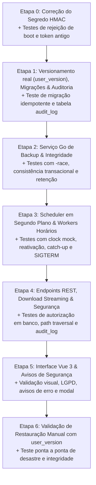

# Plano de Implementação: Sistema de Backups do OptiManager (Revisão 5)

## Changelog da Revisão 5
- **Item 1 (.env.example sem chave pré-gerada e script init-env.sh)**: Definido que `.env.example` conterá um placeholder óbvio rejeitado pelo boot (`JWT_SECRET=CONFIGURE_UMA_CHAVE_COM_PELO_MENOS_32_CHARS_AQUI`). Criado o script `scripts/init-env.sh` para gerar `JWT_SECRET` criptográfico via `openssl rand -hex 32` sem sobrescrever `.env` existente.
- **Item 2 (Terminologia do log de restauração)**: Removido o termo "imutável" de `restore_audit.log`, documentando-o como append-only por convenção de escrita (`os.O_APPEND`).
- **Item 3 (Origem `premigration` e aborto de migração)**: Adicionada a origem `premigration` à convenção de nomenclatura, regex (`manual|auto|prerestore|premigration`) e retenção (`backup_retencao_premigration`, mín. 3). Se o snapshot pré-migração falhar, o processo de migração não é executado e o boot da aplicação aborta imediatamente.
- **Item 4 (Atomicidade de migração e user_version)**: Definido explicitamente que cada script de migração DDL/DML e o comando `PRAGMA user_version = N` são executados obrigatoriamente dentro da **mesma transação**.
- **Item 5 (Controle de Proxy Confiável para IP)**: Extração de IP via cabeçalhos `X-Forwarded-For` / `X-Real-IP` (`chi/middleware.RealIP`) habilitada **apenas se `TRUST_PROXY=true`**; caso contrário, utiliza-se estritamente `r.RemoteAddr`, prevenindo spoofing de auditoria.
- **Item 6 (Ordem estrita de Shutdown)**: Definida a ordem obrigatória de encerramento do servidor: (1) parar de aceitar novas requisições HTTP (`server.Shutdown`); (2) aguardar conclusão de backup em andamento (até 30s); (3) somente após isso, encerrar os pools de conexão com o banco de dados (`db.Close()`).
- **Item 7 (Nomes únicos e ciclo de vida do `.perm_check`)**: O teste periódico de escrita no volume externo utiliza nome único por execução (`.perm_check_<timestamp>_<rand>`), limpeza garantida via `defer os.Remove`, sendo explicitamente ignorado pela listagem de backups e pela varredura de órfãos.
- **Item 8 (Caso-controle no teste de consistência transacional)**: O teste de concorrência passa a incluir caso-controle executado contra uma cópia ingênua de arquivo (sem `VACUUM INTO`, ex: `io.Copy`), comprovando que a cópia ingênua falha ao detectar inconsistências ou linhas particionadas sob escritas simultâneas.

---

## 1. Visão Geral da Arquitetura & Armazenamento

O OptiManager utiliza **SQLite em modo WAL** armazenado em volume persistente (`/data/optimanager.db`). Todos os dados do sistema estão unificados neste banco:
- Dados institucionais da empresa, logotipo base64, cores, termos de garantia e presets (`config`)
- Usuários, credenciais com hash seguro (bcrypt) e papéis de acesso (`usuarios`)
- Clientes, contatos e documentos (`clientes`)
- Ordens de serviço, histórico técnico, datas e situações de pagamento (`ordens_servico`)
- Atalhos úteis do MEI (`atalhos`)
- Registros de auditoria de operações sensíveis (`audit_log`)

### 1.1. Comportamento Real do SQLite WAL
O backup consiste na execução do comando SQL nativo do SQLite:
```sql
VACUUM INTO '/data/backups/optimanager_backup_YYYY-MM-DD_HH-mm-ss_[manual|auto|prerestore|premigration].db.tmp';
```
> [!NOTE]
> **Comportamento de Bloqueio em WAL:**
> O `VACUUM INTO` gera um snapshot transacionalmente consistente sem travar leitores nem inserções na base de produção. No entanto, **durante a sua execução, o checkpoint do log WAL não avança**. Por esse motivo, a operação deve ser serializada, veloz e protegida por timeout. O arquivo gerado é estritamente no formato `.db` íntegro.

### 1.2. Topologia de Armazenamento & Proteção contra Falha de Disco
Backups mantidos exclusivamente dentro do mesmo volume/disco (`/data/backups`) não protegem contra corrupção física ou perda do volume do host.
- **Destino Primário (Local):** `/data/backups` (ou `./data/backups` em desenvolvimento).
- **Destino Secundário Opcional (Externo):** Diretório configurável via variável de ambiente `BACKUP_EXTERNAL_DIR` (ex: `/backups-externo`, montado via volume Docker secundário ou NFS).
- **Diferenciação Crítica de Falhas de Espaço:**
  - **Falta de espaço no destino LOCAL:** Aborta imediatamente o processo com erro claro, sem gerar snapshot incompleto.
  - **Falta de espaço ou falha de escrita no destino EXTERNO:** O backup local é concluído com sucesso e preservado; a falha de sincronização externa é registrada no campo persistente `backup_ultimo_aviso_externo` e apresentada com destaque na UI.
- **Verificação Periódica com Nomes Únicos (`.perm_check`):**
  - Além do boot, um worker horário executa a criação e remoção de um arquivo com nome único (`.perm_check_<timestamp>_<rand>`) no destino externo, com `defer os.Remove(...)`.
  - Esse arquivo de verificação é explicitamente ignorado pela regex de listagem e pela rotina de limpeza de órfãos.
- **Aviso Fixo na Interface:** Alerta persistente na tela informando que backups armazenados no mesmo servidor/disco não substituem a guarda externa periódica.

### 1.3. Origem do Segredo HMAC da Sessão & Nova Política de Segurança
- O segredo lê `JWT_SECRET`. O fallback hardcoded estático é **removido**.
- **Validação de Boot (Etapa 0):**
  - O servidor valida `JWT_SECRET`:
    - Se ausente (e não for `APP_ENV=dev`): encerra o processo imediatamente (`log.Fatalf`).
    - Se tiver menos de **32 caracteres (256 bits)**: encerra imediatamente com erro explicativo.
    - Se for idêntico ao antigo fallback `"optimanager-default-secret-key-2026-hmac-sha256"`: rejeita o boot por chave comprometida.
    - Se for igual a placeholders de documentação (ex: `"CONFIGURE_UMA_CHAVE_COM_PELO_MENOS_32_CHARS_AQUI"`): rejeita o boot.
  - **Ambiente de Desenvolvimento (`APP_ENV=dev`):** Se `JWT_SECRET` estiver ausente, permite geração de chave aleatória efêmera de 32 bytes (via `crypto/rand`) no boot com aviso destacado em log.
- **Scripts de Auxílio:**
  - `.env.example`: contém placeholder óbvio intencionalmente rejeitado no boot.
  - `scripts/init-env.sh`: gera `.env` com chave de alta entropia (`openssl rand -hex 32`) se `.env` não existir.

---

## 2. Modelo de Dados, Configurações & Auditoria

### 2.1. Versionamento Real do Schema (`PRAGMA user_version`)
- O OptiManager adota versionamento numérico estrito gerenciado por migrações sequenciais numeradas em `internal/database/migrations/` (ex: `001`, `002`).
- **Atomicidade Total:** Cada migração e o incremento do `PRAGMA user_version = N` são executados dentro da **mesma transação SQL**. Se qualquer DDL/DML falhar, a transação sofre rollback e `user_version` permanece intacto.
- **Backup Pré-Migração (`premigration`):** Antes de aplicar qualquer migração nova em base existente, o sistema executa automaticamente `CreateBackup("premigration")`. **Se o backup pré-migração falhar por qualquer motivo (ex: disco cheio), as migrações NÃO são executadas e o boot da aplicação aborta imediatamente.**

### 2.2. Colunas de Backup na Tabela `config`

| Coluna | Tipo | Padrão | Descrição |
|---|---|---|---|
| `backup_auto_enabled` | INTEGER | `0` | `0` = desativado, `1` = ativo |
| `backup_frequencia` | TEXT | `'diario'` | Enum restrito: `'diario'` ou `'semanal'` |
| `backup_dia_semana` | INTEGER | `0` | `0` (Domingo) a `6` (Sábado) para frequência semanal |
| `backup_horario` | TEXT | `'02:00'` | Horário de disparo no formato `HH:MM` (fuso SP) |
| `backup_retencao_auto` | INTEGER | `7` | Quantidade de cópias automáticas mantidas (1 a 60) |
| `backup_retencao_manual` | INTEGER | `5` | Quantidade de cópias manuais mantidas (1 a 60) |
| `backup_retencao_prerestore` | INTEGER | `3` | Quantidade de cópias pré-restore mantidas (3 a 60) |
| `backup_retencao_premigration` | INTEGER | `3` | Quantidade de cópias pré-migração mantidas (3 a 60) |
| `backup_ultimo_sucesso` | TEXT | `''` | Timestamp ISO 8601 do último backup com êxito (vazio = nunca) |
| `backup_ultimo_erro` | TEXT | `''` | Mensagem do último erro ocorrido na rotina local |
| `backup_ultimo_erro_em` | TEXT | `''` | Timestamp ISO 8601 da ocorrência do último erro local |
| `backup_ultimo_aviso_externo` | TEXT | `''` | Mensagem do último aviso/erro de cópia para destino externo |
| `backup_ultimo_aviso_externo_em` | TEXT | `''` | Timestamp ISO 8601 da falha de cópia externa |

### 2.3. Tabela de Auditoria (`audit_log`) & Rastreamento Seguro de IP
```sql
CREATE TABLE IF NOT EXISTS audit_log (
    id INTEGER PRIMARY KEY AUTOINCREMENT,
    usuario_id INTEGER NOT NULL,
    usuario_nome TEXT NOT NULL,
    ip TEXT NOT NULL,
    acao TEXT NOT NULL,
    detalhe TEXT NOT NULL,
    created_at DATETIME NOT NULL DEFAULT CURRENT_TIMESTAMP
);
CREATE INDEX IF NOT EXISTS idx_audit_log_created_at ON audit_log (created_at DESC);
```
- **Rastreamento de IP com Validação de Proxy:**
  - Se `TRUST_PROXY=true`: utiliza o IP resolvido por `chi/middleware.RealIP` (avaliando `X-Forwarded-For` e `X-Real-IP`).
  - Se `TRUST_PROXY` for falso ou ausente: utiliza estritamente `r.RemoteAddr` (ignorando qualquer cabeçalho HTTP de cliente), impedindo falsificação de IP em redes abertas.
- **Política de Retenção:** Retenção documentada com padrão de 365 dias (`audit_retencao_dias INTEGER DEFAULT 365`).

---

## 3. Backend (Go): Serviço de Backup & Integridade

O serviço residirá em `internal/services/backup/service.go`.

### 3.1. Inicialização e Limpeza de Órfãos
No boot da aplicação:
1. Cria os diretórios `/data/backups` e o destino externo (se configurado).
2. Varre arquivos `*.db.tmp` órfãos deixados por falhas abruptas anteriores e os remove imediatamente com log de aviso. Arquivos `.perm_check*` também são limpos se existirem.
3. Executa a primeira checagem com nome único `.perm_check_<timestamp>_<rand>`.

### 3.2. Concorrência e Criação Segura (`CreateBackup`)
1. **Serialização estrita:** Uso de `sync.Mutex`. Backups manuais, automáticos, pré-restore e pré-migração nunca concorrem.
2. **Checagem de Espaço Livre:**
   - Destino local: Exige espaço livre >= 2x o tamanho do banco atual. Se insuficiente, aborta a operação.
   - Destino externo: Exige espaço livre >= 2x o tamanho do banco atual. Se insuficiente, registra aviso e prossegue gerando o backup local.
3. **Resolução de Colisão de Nomes com Respeito a Contexto:**
   - O nome segue: `optimanager_backup_YYYY-MM-DD_HH-mm-ss_[manual|auto|prerestore|premigration].db`
   - Se o arquivo já existir no mesmo segundo:
     ```go
     select {
     case <-ctx.Done():
         return nil, ctx.Err()
     case <-time.After(1 * time.Second):
     }
     ```
     Repete até 3 tentativas. Se ainda colidir, aborta com erro.
4. **Arquivo Temporário:** Snapshot gerado como `...db.tmp`.
5. **Validação de Integridade Pós-Criação:**
   - Abre o `.db.tmp` em conexão SQLite separada em modo somente leitura.
   - Executa `PRAGMA integrity_check;`. Se retornar resultado diferente de `"ok"`, remove o `.tmp` e aborta.
6. **Finalização Atômica:** Executa `os.Rename(tmpFile, finalFile)`. Um `defer` com verificação de sucesso garante que qualquer falha ou interrupção remova o `.db.tmp`.
7. **Cópia para Destino Externo (se configurado):** Transfere o arquivo validado. Se falhar, registra `backup_ultimo_aviso_externo` no banco sem invalidar o backup local.
8. **Atualização de Estado:** Atualiza `backup_ultimo_sucesso = now` e zera `backup_ultimo_erro`.
9. **Aplicação de Retenção:** Dispara `ApplyRetention(origem)`.

### 3.3. Retenção Separada por Origem (`ApplyRetention`)
A regra de corte opera de forma estritamente isolada:
- Origem `manual`: mantém os últimos `backup_retencao_manual` (padrão 5, intervalo 1-60).
- Origem `auto`: mantém os últimos `backup_retencao_auto` (padrão 7, intervalo 1-60).
- Origem `prerestore`: mantém os últimos `backup_retencao_prerestore` (padrão 3, intervalo 3-60).
- Origem `premigration`: mantém os últimos `backup_retencao_premigration` (padrão 3, intervalo 3-60).

**Salvaguardas:**
- Executada **estritamente após** o novo arquivo ter sido validado e renomeado.
- **Regra de Sobrevivência:** Nunca apaga se restar menos de 1 backup daquela origem.
- Espelhos no diretório externo correspondentes aos arquivos removidos também são deletados.

---

## 4. Scheduler em Segundo Plano

O scheduler residirá em `internal/services/backup/scheduler.go`.

### 4.1. Fuso Horário e Dependência Embutida
- Inclui o import anônimo `import _ "time/tzdata"`.
- Utiliza `time.LoadLocation("America/Sao_Paulo")`.
- `Dockerfile` e `docker-compose.yml` definem `TZ=America/Sao_Paulo`.

### 4.2. Lógica "Venceu?", Primeira Ativação e Reativação
1. **Se `backup_auto_enabled == 0`**: O scheduler não dispara.
2. **Primeira Ativação (`backup_ultimo_sucesso == ""`):**
   - Não dispara retroativamente no instante da ativação. Programa a execução para o próximo horário futuro configurado.
3. **Reativação com Histórico Defasado:**
   - Se o usuário desativou a rotina e posteriormente reativou (`backup_auto_enabled = 1`) tendo `backup_ultimo_sucesso` anterior à última janela esperada, o scheduler detecta que o backup está vencido e dispara imediatamente o **catch-up**, restabelecendo a proteção.
4. **Execuções Subsequentes Contínuas:**
   - Se `agora >= ultima_janela_esperada` e `backup_ultimo_sucesso < ultima_janela_esperada`, executa imediatamente (recuperação pós-downtime).

### 4.3. Ordem Estrita de Shutdown e Ajuste de Docker
- No `docker-compose.yml`:
  ```yaml
  stop_grace_period: 40s
  ```
- **Sequência Obrigatória de Desligamento no Backend:**
  1. O servidor encerra a escuta HTTP e para de aceitar novas requisições (`server.Shutdown(ctx)`).
  2. Aguarda até **30 segundos** pela finalização de qualquer `CreateBackup` em andamento.
  3. Somente após a conclusão (ou cancelamento por timeout de 30s com remoção do `.tmp`), fecha os pools de conexão com o banco SQLite (`db.Close()`).
  4. O container Docker aguarda até 40s antes de qualquer `SIGKILL`, garantindo 10s de folga de encerramento.

---

## 5. Segurança, Auditoria & Endpoints da API

Endpoints agrupados em `/api/backups` com verificação de role admin direto no SQLite a cada requisição:

| Método | Endpoint | Regras de Validação & Segurança |
|---|---|---|
| `GET` | `/api/backups` | Lista backups existentes. Ignora arquivos fora da regex. Retorna metadados, status da rotina e alertas externos. |
| `POST` | `/api/backups` | Dispara criação imediata de backup com origem `manual`. Serializado via Mutex. Grava em `audit_log`. |
| `GET` | `/api/backups/config` | Retorna configurações de rotina, retenções, status e erros. |
| `PUT` | `/api/backups/config` | Valida payload: enum de frequência, dia da semana, horário `HH:MM`, retenções nos intervalos válidos. Grava em `audit_log`. |
| `GET` | `/api/backups/{filename}/download` | Validação estrita do filename + `filepath.Rel`. Streaming via `http.ServeContent` com `Content-Disposition: attachment; filename="..."` e `Cache-Control: no-store`. Grava em `audit_log`. |
| `DELETE` | `/api/backups/{filename}` | Validação estrita do filename + `filepath.Rel`. Exclusão local e externa. Grava em `audit_log`. |

### 5.1. Validação Estrita de Arquivo
Expressão regular rígida para qualquer parâmetro `{filename}`:
```regex
^optimanager_backup_\d{4}-\d{2}-\d{2}_\d{2}-\d{2}-\d{2}_(manual|auto|prerestore|premigration)\.db$
```
Validação cruzada com `filepath.Rel` e existência física na pasta.

---

## 6. Interface de Usuário (Vue 3 / Tailwind CSS)

Painel dedicado em `ConfiguracoesView.vue`:
1. **Avisos Fixos:**
   - **Perda de Disco Físico:** Alerta sobre a necessidade de download periódico ou volume montado externo.
   - **Conformidade LGPD:** Aviso sobre a presença de dados pessoais e credenciais protegidas no arquivo.
2. **Monitoramento em Tempo Real:**
   - **Alerta de Atraso (> 2x frequência):** Banner amarelo/vermelho caso o último sucesso tenha ocorrido há mais de 2x o intervalo.
   - **Alerta de Erro Local:** Exibição destacada de `backup_ultimo_erro` com data de ocorrência.
   - **Alerta de Erro de Cópia Externa:** Exibição de `backup_ultimo_aviso_externo` com data de ocorrência, atualizado pelo worker horário.
   - **Status do Destino Secundário:** Indicador visual de saúde da montagem externa.
3. **Ações:**
   - Botão **"Criar Backup Agora"** com feedback visual de carregamento.
   - Formulário de agendamento (frequência diário/semanal, dia, hora e retenções separadas).
   - Tabela com histórico, download streaming direto e exclusão com modal de confirmação.

---

## 7. Estratégia de Restauração de Dados

### 7.1. Fase 1: Procedimento Manual com Verificação de `user_version`
1. Parar o container: `docker compose stop optimanager`.
2. Fazer cópia de segurança do banco ativo: `cp /data/optimanager.db /data/optimanager.db.old`.
3. **Verificação de `user_version`:**
   ```bash
   sqlite3 /data/backups/optimanager_backup_...db "PRAGMA user_version;"
   ```
   Conferir se a versão do schema do backup é menor ou igual à suportada pelo binário atual, impedindo downgrade com perda de compatibilidade.
4. Substituir o banco pelo backup: `cp /data/backups/optimanager_backup_...db /data/optimanager.db`.
5. Remover arquivos residuais do WAL: `rm -f /data/optimanager.db-wal /data/optimanager.db-shm`.
6. Reiniciar o container: `docker compose up -d optimanager`.
7. O OptiManager iniciará em modo WAL, executará eventuais migrações pendentes e atualizará o `user_version`.

### 7.2. Fase 2: Restauração Automatizada via Painel com Log Sobrevivente
1. **Validação do Arquivo:** Checagem de cabeçalho SQLite, `PRAGMA integrity_check`, tabelas essenciais e `user_version <= VersaoApp`.
2. **Snapshot de Salvaguarda ("Pre-Restore"):** Execução automática de `CreateBackup("prerestore")`.
3. **Registro de Auditoria Sobrevivente:**
   - O evento de restauração é **gravado em arquivo append-only por convenção (`/data/restore_audit.log`, modo `os.O_APPEND`)**.
4. **Substituição Segura da Conexão:**
   - Fechar os pools `Writer` e `Reader` do banco.
   - Excluir `-wal` e `-shm`.
   - Substituir o arquivo principal `.db`.
   - Reabrir os pools de conexão e rodar migrações incrementais.
   - **Reinjetar** o registro do evento de restauração na tabela `audit_log` da nova base.
5. **Segurança de Sessão:** Invalidação total de sessões ativas e exigência de reautenticação.

---

## 8. Etapas de Implementação com Testes Integrados



### Detalhamento por Etapa:

#### Etapa 0: Correção do Segredo HMAC
- Remover fallback estático em `internal/handlers/auth.go`.
- Validar `JWT_SECRET` no boot (mínimo 32 caracteres, proibir valor antigo e placeholders). Em `APP_ENV=dev`, permitir segredo aleatório gerado no boot com aviso.
- Criar `scripts/init-env.sh` e atualizar `.env.example`.
- **Testes Obrigatórios:**
  - Falha no boot sem `JWT_SECRET` (quando não estiver em `APP_ENV=dev`).
  - Falha no boot com segredo com menos de 32 caracteres.
  - Falha no boot com segredo igual ao fallback antigo.
  - Falha no boot com segredo igual ao placeholder do `.env.example`.
  - Rejeição de tokens gerados com o segredo antigo.
  - Em `APP_ENV=dev`, boot com segredo gerado aleatório e validação de tokens.

#### Etapa 1: Versionamento Real do Schema (`user_version`), Migrações Atômicas e Auditoria
- Introduzir `PRAGMA user_version` incremental e migrações numeradas em transações atômicas únicas.
- Implementar backup automático pré-migração (`premigration`) que aborta o boot se falhar.
- Criar tabela `audit_log` e controle de `TRUST_PROXY`.
- **Testes Obrigatórios:**
  - Aplicação sequencial de migrações garantindo incremento atômico de `user_version`.
  - Aborto do boot caso snapshot pré-migração falhe.
  - Inserção e leitura de registros na tabela `audit_log` com IP respeitando `TRUST_PROXY`.

#### Etapa 2: Serviço Go de Backup (`internal/services/backup`)
- Implementar `CreateBackup`, limpeza de órfãos no boot, checagem de espaço duplo, espera de colisão com `ctx.Done()`, `integrity_check`, cópia externa e retenção separada por origem (`manual`, `auto`, `prerestore`, `premigration`).
- **Testes Obrigatórios (com `go test -race`):**
  - **Consistência Transacional com Caso-Controle:** Executar escritas concorrentes em pares de tabelas dependentes durante `CreateBackup`. Validar que `VACUUM INTO` preserva transações intactas e que a **cópia ingênua de arquivo (caso-controle sem VACUUM INTO) falha**, detectando inconsistências.
  - **Roundtrip e integridade:** Validação de `PRAGMA integrity_check` e comparação de dados.
  - **Remoção de .tmp e órfãos:** Simulação de erro de snapshot e limpeza no startup.
  - **Retenção isolada:** Validação de que limites das 4 origens não se misturam e respeitam o mínimo de 1.

#### Etapa 3: Scheduler em Segundo Plano & Workers Periódicos
- Implementar worker com `_ "time/tzdata"`, fuso `America/Sao_Paulo`, cálculo de próxima execução, tratamento de primeira ativação, reativação com catch-up, worker horário com `.perm_check` único e graceful shutdown (aguardar até 30s antes de fechar o banco).
- **Testes Obrigatórios:**
  - **Primeira ativação:** Rotina ativada com `backup_ultimo_sucesso == ""` aguarda próximo horário futuro.
  - **Reativação:** Rotina desativada e reativada com `backup_ultimo_sucesso` defasado dispara catch-up imediato.
  - **Graceful shutdown:** Simular cancelamento de contexto e comprovar que processo aguarda o backup ou cancela limpando `.tmp`.

#### Etapa 4: Endpoints da API, Download Streaming e Segurança Rígida
- Implementar handlers em `internal/handlers/backup.go` com checagem de role admin direto no SQLite, validação de regex, mitigação `filepath.Rel`, streaming com `http.ServeContent` e gravação em `audit_log`.
- **Testes Obrigatórios:**
  - **Path Traversal e Regex:** Tentativas de evasão com `../`, origens inválidas ou extensões diferentes retornam erro 400/403.
  - **Autenticação e Role em Banco:** Requisições com perfil operador ou usuário rebaixado no banco retornam `403 Forbidden`.
  - **Download Streaming:** Download de arquivo com conferência de headers `Content-Disposition`, `Cache-Control: no-store` e integridade do binário.
  - **Auditoria:** Gravação de linhas em `audit_log` com IP e dados do usuário.

#### Etapa 5: Interface de Usuário (Vue 3 / Tailwind)
- Painel de Backups em `ConfiguracoesView.vue` com avisos fixos (perda de disco e LGPD), alertas visuais (atraso > 2x e falhas de cópia externa), formulário e modal de exclusão.
- **Testes Obrigatórios:**
  - Compilação do frontend com `vue-tsc --noEmit && vite build`.
  - Validação de renderização dos alertas e fluxos de criação/download.

#### Etapa 6: Teste do Procedimento Manual de Restauração
- Teste operacional ponta a ponta:
  - Criação de backup.
  - Modificação de dados no banco ativo.
  - Verificação de `user_version` no arquivo de backup.
  - Substituição manual de `/data/optimanager.db` com expurgo de `-wal` e `-shm`.
  - Reinicialização e conferência da recuperação íntegra dos dados.

---

## 9. Pontos para Avaliação & Dúvidas

1. **Rotação do Arquivo de Log de Restauração (`/data/restore_audit.log`):**
   - Mantido como arquivo append-only por convenção (`os.O_APPEND`), com registro contendo timestamp, usuário, IP e arquivo restaurado.
