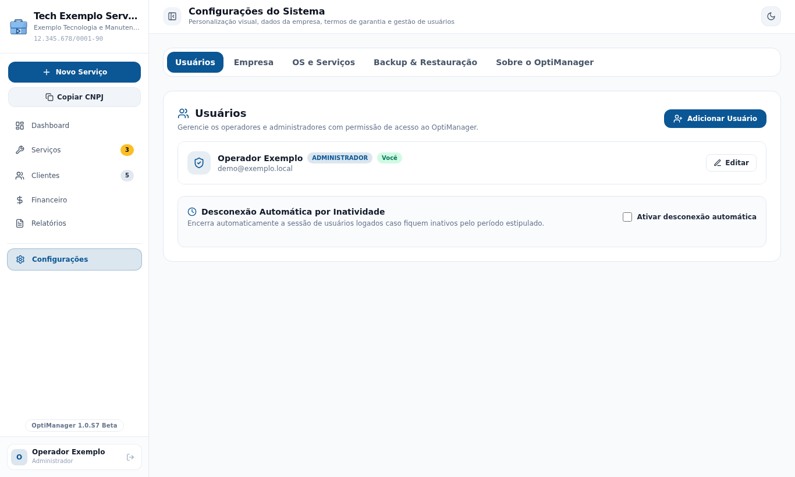

# Módulo: Configurações

## Visão geral e problema que resolve
Centraliza a identidade visual da empresa (logotipo e cores de destaque / accent colors), dados cadastrais, personalização dos campos e listas de **OS e Serviços**, segurança de sessão (auto-logout por inatividade) e informações institucionais (**Sobre o OptiManager**).

## Como usar (passo a passo do ponto de vista do técnico)
1. Acesse **Configurações** na barra lateral (`ConfiguracoesView.vue`).
2. Na aba **Empresa**:
   - Envie ou remova o logotipo (PNG/JPG até 1,5 MB).
   - Selecione uma paleta rápida ou defina manualmente `cor_primaria` e `cor_secundaria` (accent colors aplicadas em tempo real).
   - Edite Nome Fantasia, Razão Social, CNPJ, Número de Contato, E-mail, Endereço e Cidade e clique em **Salvar Alterações**.
3. Na aba **OS e Serviços**:
   - Defina o próximo número da OS, ative/renomeie as caixas de texto (**Descrição do Serviço** e **Caixa personalizada 2**), ajuste **Informações de Garantia**, **Informações Adicionais** e personalize as listas de **Fabricante**, **Modelo**, **Serviços Comuns**, **Estados de Serviço** e **Formas de Pagamento**.
4. Na aba **Sobre o OptiManager**:
   - Consulte a versão (`1.0.S7 Beta`), links para GitHub, Site Oficial, Documentação (`docs/`) e Licença GPLv3, além do resumo de **Informações da empresa definidas para esta instalação**.

## Como funciona por dentro
1. `GET /api/config` é público para permitir que a tela de login/setup exiba logo, nome fantasia e cores configuradas.
2. `configStore.applyColorTheme(primaryHex, secondaryHex)` calcula variações RGB e injeta `--color-primary`, `--color-primary-rgb`, `--color-primary-dark`, `--color-primary-dark-rgb`, `--color-primary-light` e `--color-primary-soft` no `:root` do documento.
3. Alterações são enviadas via `PUT /api/config` (`ConfigHandler.Update`), protegido por `RequireAdmin` e controle de concorrência otimista (`versao`).
4. As listas e opções de OS são serializadas como JSON na coluna `custom_presets` da tabela `config`.

## Entradas, saídas e configurações
- **Endpoints:** `GET /api/config` (público), `PUT /api/config` (admin).
- **Persistência:** tabela `config` (linha única `id = 1`) no SQLite; tema claro/escuro salvo no navegador (`optimanager_theme` no `localStorage`).

## Requisitos
- **Admin no sistema (OptiManager):** obrigatório para salvar qualquer alteração (`PUT /api/config`).
- **Admin no Windows / Dependências externas:** nenhum.

## Riscos e efeitos colaterais
- Alterar o próximo número da OS ou desativar seções de texto afeta imediatamente os formulários de criação/edição de OS e relatórios.
- Alterar `logo_base64` substitui o logotipo exibido no cabeçalho e documentos.

## Logs e tratamento de erros
- Tentativas de edição simultânea retornam `409 Conflict` (`version_conflict`).
- Imagens maiores que 1,5 MB são bloqueadas no navegador antes do envio.

## Arquivos-fonte relacionados
- `internal/handlers/config.go`
- `internal/database/config_repo.go`
- `internal/models/config.go`
- `ui/src/views/ConfiguracoesView.vue`
- `ui/src/stores/config.ts`
- `ui/src/style.css`
- `ui/tailwind.config.js`
