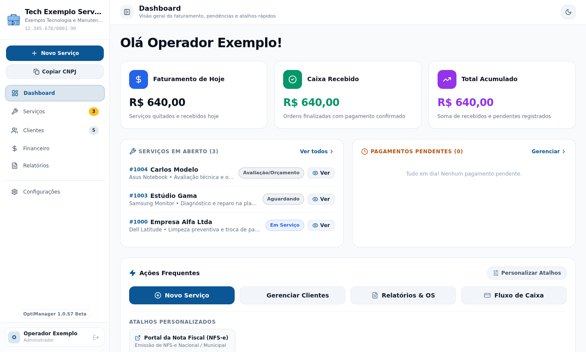

# Módulo: Dashboard e Atalhos

## Visão geral e problema que resolve
Fornece uma visão consolidada do negócio logo após o login (ordens em aberto, cobranças pendentes, métricas principais), recomendações operacionais contextuais e um painel de **Ações Frequentes** com atalhos personalizados para ferramentas ou links externos.

## Como usar (passo a passo do ponto de vista do técnico)
1. Após o login, a tela inicial **Dashboard** é aberta automaticamente.
2. Consulte os cards de **Serviços em Aberto** e **Pagamentos Pendentes** e clique em **Ver** para abrir uma OS ou **Ver todos** / **Gerenciar** para filtrar na tela de Serviços.
3. Na seção **Ações Frequentes**, utilize os botões rápidos (**Novo Serviço**, **Gerenciar Clientes**, **Relatórios & OS**, **Fluxo de Caixa**).
4. Caso seja administrador, clique em **Personalizar Atalhos** para adicionar, editar ou remover links externos exibidos no painel.

## Como funciona por dentro
1. `DashboardView.vue` carrega os dados via `dashboardStore.loadDashboard()`, que chama `GET /api/dashboard`.
2. `DashboardHandler.Get` consulta `internal/database/dashboard_repo.go` para agregar métricas, listas de ordens abertas, cobranças pendentes e atalhos cadastrados.
3. Se o usuário não possuir a permissão `ver_valores`, os campos financeiros retornados são zerados/ocultados antes da serialização.
4. Atalhos personalizados são gerenciados via `/api/atalhos` (`AtalhoHandler`), com mutações restritas a administradores (`RequireAdmin`).
5. Recomendações dispensadas pelo usuário são armazenadas localmente no navegador (`localStorage`, chave `optimanager_dismissed_recs`).

## Entradas, saídas e configurações
- **Endpoints:**
  - `GET /api/dashboard` (autenticado)
  - `GET /api/atalhos` (autenticado)
  - `POST /api/atalhos`, `PUT /api/atalhos/{id}`, `DELETE /api/atalhos/{id}` (admin)
- **Persistência:** tabela `atalhos` no SQLite e `localStorage` para recomendações dispensadas.

## Requisitos
- **Admin no sistema (OptiManager):** necessário apenas para criar, editar ou remover atalhos personalizados.
- **Admin no Windows / Dependências externas:** nenhum.

## Riscos e efeitos colaterais
- A exclusão de um atalho remove o registro da tabela `atalhos` de forma permanente (pode ser recriado manualmente).
- Links externos cadastrados nos atalhos são abertos em nova aba do navegador (`window.open`).

## Logs e tratamento de erros
- Erros de consulta ao banco retornam HTTP `500` sanitizados por `respondError`.
- Falhas de carregamento ou salvamento exibem notificações toast na interface via `useToastStore`.

## Arquivos-fonte relacionados
- `internal/handlers/dashboard.go`
- `internal/handlers/atalho.go`
- `internal/database/dashboard_repo.go`
- `internal/database/atalho_repo.go`
- `internal/models/dashboard.go`
- `internal/models/atalho.go`
- `ui/src/views/DashboardView.vue`
- `ui/src/stores/dashboard.ts`
- `ui/src/components/GerenciarAtalhosModal.vue`
- `ui/src/components/NovoAtalhoModal.vue`
