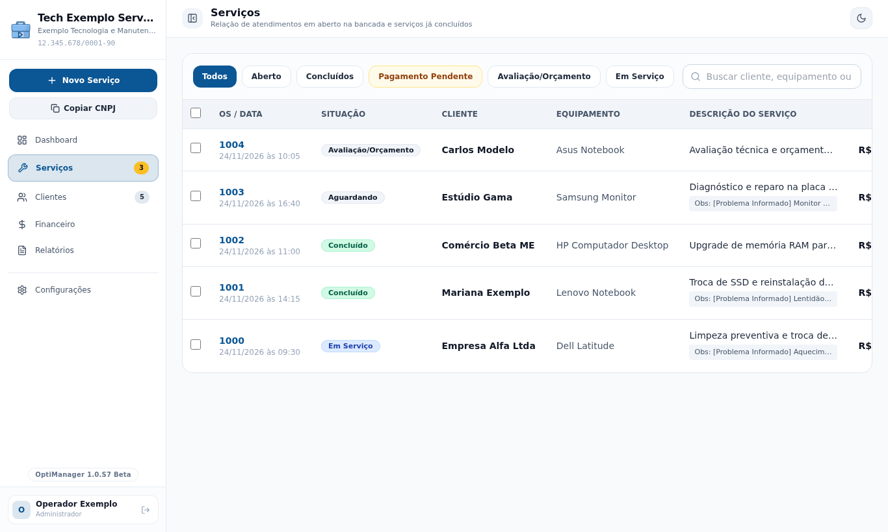

# Módulo: Ordens de Serviço

## Visão geral e problema que resolve
Centraliza o ciclo de vida completo dos serviços prestados: abertura de atendimento, vinculação de cliente (com cadastro automático se novo), descrição técnica, acompanhamento de status, registro de entrega, baixa de pagamento e ações em lote.

## Como usar (passo a passo do ponto de vista do técnico)
1. Clique em **Novo Serviço** na barra lateral ou no Dashboard para abrir `NovaOSModal.vue`.
2. Preencha cliente (selecionando um existente ou informando contato de novo cliente), fabricante, modelo, descrição do serviço, valor e situação.
3. Na aba **Serviços** (`ServicosView.vue`), filtre por status, pagamento ou texto de busca.
4. Clique em uma OS para abrir `EditarOSModal.vue`, atualizar informações, clicar em **Finalizar / Dar Baixa** (preenche data/hora de entrega e marca como concluído), **Duplicar OS** ou **Excluir OS**.
5. Selecione múltiplas OS na tabela para executar ações em lote (Dar Baixa, Mudar Estado, Duplicar ou Excluir).

## Como funciona por dentro
1. O frontend envia `POST /api/ordens` ou `PUT /api/ordens/{id}` através de `ordensStore`.
2. Os valores monetários são convertidos e armazenados em centavos (`int64`) via pacote `internal/money` e coluna `valor_total_centavos`.
3. As seções de texto editáveis combinam o primeiro campo e observações técnicas na coluna `obs_tecnicas` usando os helpers `mergeObsAndProblema` e `splitObsAndProblema` (`ui/src/utils/formatters.ts`).
4. Atualizações usam **concorrência otimista** (`versao`): se outro usuário alterou a mesma OS antes, o banco retorna `database.ErrVersionConflict` e o handler responde HTTP `409 Conflict`.
5. Operações em lote usam `POST /api/ordens/batch`.

## Entradas, saídas e configurações
- **Endpoints:**
  - `GET /api/ordens` (filtros `filtro`/`status` e `busca`/`search`)
  - `POST /api/ordens`, `POST /api/ordens/batch`
  - `GET /api/ordens/{id}`, `PUT /api/ordens/{id}`, `DELETE /api/ordens/{id}`
  - `PATCH /api/ordens/{id}/baixa`
- **Configurações aplicadas:** rótulos personalizados, listas de Fabricante/Modelo/Serviços Comuns/Estados/Formas de Pagamento e próximo número da OS (`custom_presets` em `config`).

## Requisitos
- **Admin no sistema (OptiManager):** não obrigatório para criar/editar; porém `DELETE` exige permissão `excluir`, `PATCH .../baixa` exige `ver_financeiro`, e visualização de valores exige `ver_valores`.
- **Admin no Windows / Dependências externas:** nenhum.

## Riscos e efeitos colaterais
- Excluir uma OS remove o registro do SQLite; ações de exclusão em lote não podem ser desfeitas diretamente pela UI (somente via restauração de backup).
- Conflitos de edição simultânea bloqueiam o salvamento com aviso para recarregar os dados.

## Logs e tratamento de erros
- Validações obrigatórias (`servico` e `cliente_nome` ou `cliente_id`) retornam HTTP `400 Bad Request`.
- Conflitos de versão retornam HTTP `409` (`version_conflict`), abrindo o modal de recarregamento em `App.vue`.
- Mensagens de erro retornadas pela API passam por `redact.SanitizeLogMessage`.

## Arquivos-fonte relacionados
- `internal/handlers/ordem_servico.go`
- `internal/database/os_repo.go`
- `internal/models/ordem_servico.go`
- `internal/money/money.go`
- `ui/src/views/ServicosView.vue`
- `ui/src/components/NovaOSModal.vue`
- `ui/src/components/EditarOSModal.vue`
- `ui/src/stores/ordens.ts`
