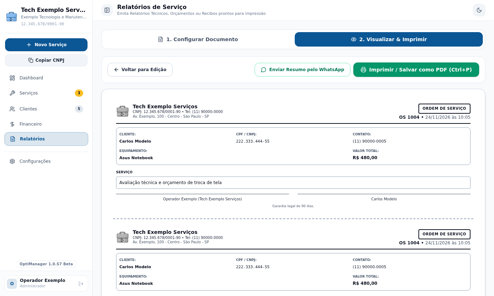

# Módulo: Relatórios e PDF

## Visão geral e problema que resolve
Permite emitir documentos prontos para entrega ao cliente (Ordem de Serviço em 2 vias, Orçamento, Relatório de Serviço e Recibo de Pagamento) em layout A4 monocromático com edição em tempo real, além de disponibilizar geração de PDF nativo no backend.

## Como usar (passo a passo do ponto de vista do técnico)
1. Acesse **Relatórios** na barra lateral (ou clique em imprimir/gerar documento a partir de uma OS).
2. Na guia **1. Configurar Documento**:
   - Pesquise e selecione a Ordem de Serviço desejada.
   - Escolha o tipo de documento (**Ordem de Serviço**, **Orçamento**, **Relatório** ou **Recibo**).
   - Ajuste, se necessário, os campos em tempo real e clique em **Avançar**.
3. Na guia **2. Visualizar & Imprimir**:
   - Confira a pré-visualização A4 em tonalidades monocromáticas.
   - Clique em **Imprimir / Salvar como PDF (Ctrl+P)** ou em **Enviar Resumo pelo WhatsApp**.

## Como funciona por dentro
1. **Na interface web (`RelatoriosView.vue`):**
   - Carrega os dados da OS selecionada, separa `obs_tecnicas` com `splitObsAndProblema` e exibe em duas guias internas (`config` e `preview`).
   - A folha `#a4-preview` usa apenas tons monocromáticos (`slate-*`, `white` e `grayscale` no logotipo) para economizar tinta/toner em impressoras térmicas ou laser P&B.
   - A impressão dispara `window.print()`, controlado pelas regras `@media print` em `ui/src/style.css`.
2. **No backend (`internal/services/pdf/pdf_service.go`):**
   - O endpoint `GET /api/ordens/{id}/pdf` (`OrdemHandler.DownloadPDF`) gera um PDF A4 binário usando a biblioteca `maroto/v2` (`relatorio`, `orcamento` ou `recibo`).

## Entradas, saídas e configurações
- **Endpoint backend:** `GET /api/ordens/{id}/pdf?tipo=relatorio|orcamento|recibo` (autenticado).
- **Configurações utilizadas:** dados da empresa (`fantasia`, `cnpj`, `fones`, `endereco`, `cidade`, `logo_base64`), `termo_garantia`, `obs_padrao` e rótulos em `custom_presets`.

## Requisitos
- **Admin no sistema / Windows:** não exigido.
- **Dependências externas:** `github.com/johnfercher/maroto/v2` no backend; navegador com suporte a impressão/PDF no frontend.

## Riscos e efeitos colaterais
- Edições feitas nos campos do Gerador de Documentos na UI alteram apenas a visualização/impressão atual e **não** modificam a OS salva no banco de dados.

## Logs e tratamento de erros
- Caso a OS não exista no endpoint `/api/ordens/{id}/pdf`, retorna `404 Not Found`.
- No envio por WhatsApp, se o cliente não possuir telefone preenchido, a UI exibe um alerta informando a ausência do número.

## Arquivos-fonte relacionados
- `ui/src/views/RelatoriosView.vue`
- `ui/src/style.css`
- `internal/services/pdf/pdf_service.go`
- `internal/handlers/ordem_servico.go` (`DownloadPDF`)
